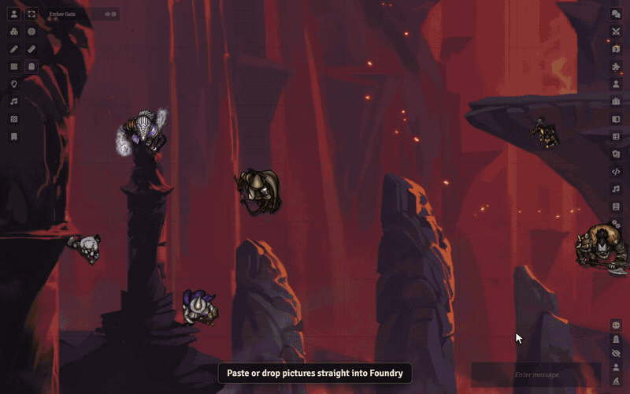

# Sephral’s Image Paste & Drop

**Found the perfect map online? Press Ctrl+V.** Image Paste & Drop turns any image from your clipboard, your desktop or a web page into a scene, a tile, a handout or a picture for your players, in seconds.

## Highlights

* **Paste or drop:** paste a screenshot or a copied image address with Ctrl+V, or drag an image file or a picture from your browser onto Foundry.
* **You decide what it becomes:** a new scene with the image as its background, the background or foreground of the current scene, a tile, a journal page, a map pin, a token image, an actor portrait, a chat post or a picture shown to all players or just the ones you pick.
* **Drop it where it belongs:** drop an image onto a token, a tile or an open sheet and it becomes that picture. A soft glow shows where it will land.
* **Several images at once:** drop a handful of files and turn them into one handout with a page each, a neat grid of tiles or a new scene per map.
* **Tiles where you want them:** drop an image onto the map and the tile lands right there, snapped to the grid.
* **Maps with the right grid:** a map named `Tavern 30x20` becomes a scene with a grid that fits. Or type the size of a square into the dialog.
* **Animated maps too:** drop a WebM or MP4 video and it plays as scene background, tile, token or handout.
* **One key and done:** Alt+V sends the copied image to your usual target, Alt+P shows it to your players at once.
* **No file juggling:** the image is uploaded and filed away for you. No detour through the file picker, and the same image is never stored twice. Huge images can be shrunk and saved as WebP on the way.
* **Image links too:** copy an image address in your browser and paste it. If the site blocks the download, you can still link the image directly.
* **Players can join in:** let players show images, create handouts or give their own token a new look, with exactly the permissions you choose.
* **Remembers your routine:** set a default target or reuse the last one, so the next image takes a single click.

## How it works

1. Copy an image or an image address, or grab a file from your desktop.
2. Press Ctrl+V anywhere outside a text field, or drop it onto Foundry.
3. Pick a target in the preview dialog and confirm.

By default only the GM can use it. Player access is one setting away.

## Install

Search for **Image Paste & Drop** in Foundry's module browser or open the [package page](https://foundryvtt.com/packages/sephrals-image-paste-drop).

Foundry VTT 13 and 14 · any game system · works on The Forge · English and German

## Learn more

The [manual](MANUAL.md) explains every target, the player permissions, where images are stored and how to choose your own storage folder.

Questions or ideas? Join us on [Discord](https://discord.gg/7BjCgDYaBP). Looking for more? See [all modules by Sephral](https://github.com/Sephral).

## License

See [LICENSE.md](LICENSE.md).
